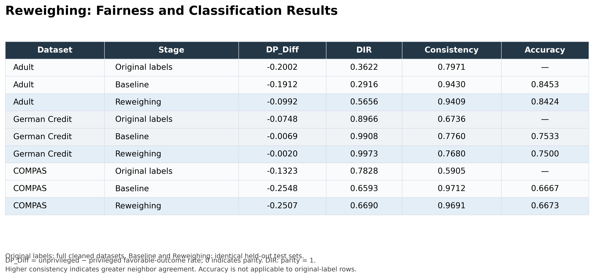

# Reweighing for Bias Mitigation

Assignment 4 | Data Wrangling | MSc Applied Data Science  
Author: Karla Hernandez Guerrero

## Overview

This project implements and evaluates Reweighing using IBM’s AI Fairness 360 (AIF360) library. It accompanies a review of Kamiran and Calders’ (2012) paper, “Data preprocessing techniques for classification without discrimination,” which develops earlier work by Calders, Kamiran, and Pechenizkiy (2009).

The analysis examines whether Reweighing reduces disparities in favorable-outcome rates while maintaining classification performance. It evaluates the method in a new experimental setting rather than reproducing the original paper’s numerical results.

Reweighing assigns weights to training observations based on their sensitive-group and outcome-label combinations. It changes their influence during training without changing their feature values or labels.

## Datasets and sensitive attributes

| Dataset | File | Sensitive attribute | Favorable outcome |
|---|---|---|---|
| Adult Census | `adult.csv` | `sex` | Income above 50K |
| German Credit | `german.data` | `sex`, derived from `personal_status_sex` | Good credit |
| COMPAS | `compas-scores-two-years.csv` | `race` | No recorded recidivism within two years |

Upload `adult.csv` and `german.data` to Google Colab before running the data-loading cell. The notebook downloads the correct COMPAS file automatically if it is not already present in the session.

### Why use german.data?

The notebook uses `german.data`, the original German Credit dataset, because it matches the defined column names and preserves the categorical codes used to derive `sex` from `personal_status_sex`.

The alternative, `german.data-numeric`, contains numerically encoded features and additional indicator variables. It is not used because the notebook handles categorical encoding during preprocessing.

The accompanying `german.doc` file provides documentation rather than observations and is not loaded into the pipeline.

### Which COMPAS file is used?

The analysis uses ProPublica’s `compas-scores-two-years.csv`, which contains the observed two-year recidivism label required for this experiment.

The earlier assessment-only file named `compas.csv` is not used. Risk-assessment scores cannot substitute for observed recidivism labels.

Source: https://github.com/propublica/compas-analysis

## Preprocessing

The notebook:

- Standardizes column names and text categories to lowercase and removes surrounding whitespace.
- Converts designated missing-value markers to missing values and removes rows with missing values in the selected modeling columns.
- Encodes favorable outcomes as `1` and unfavorable outcomes as `0`.
- Excludes Adult’s `fnlwgt` column from predictors.
- Derives the German Credit sensitive attribute from `personal_status_sex`, then removes the combined column from predictors.
- Applies COMPAS screening filters and restricts the group comparison to African-American and Caucasian observations.
- Excludes identifiers, existing risk scores, and later outcome information from COMPAS predictors.
- Standardizes numerical predictors and one-hot encodes categorical predictors using transformations fitted only on training data.

### Group definitions

| Dataset | Unprivileged group: `protected = 0` | Privileged group: `protected = 1` |
|---|---|---|
| Adult Census | Female | Male |
| German Credit | Female | Male |
| COMPAS | African-American | Caucasian |

These operational group definitions remain unchanged throughout evaluation.

The selected sensitive attribute is excluded from classifier inputs but used to calculate Reweighing weights and evaluate group fairness. Other attributes remain available as predictors; for example, COMPAS retains `sex` while evaluating disparities by `race`.

## Evaluation

Before applying Reweighing or training either classifier, the notebook calculates the following metrics using the original labels of each full cleaned dataset:

- Demographic parity difference (`DP_Diff`)
- Disparate impact ratio (`DIR`)
- Consistency

It also calculates original-label metrics for the held-out test subset as an additional reference.

The notebook then compares:

1. An unweighted logistic-regression baseline.
2. Logistic regression trained with Reweighing instance weights.

Both classifiers use the same features, model settings, train/test split, and held-out test observations. The training weights are the intended difference between the two models.

### Experimental settings

| Setting | Value |
|---|---|
| Train/test split | 70/30 |
| Stratification | Jointly by sensitive group and outcome label |
| Random seed | `42` |
| Classifier | Logistic regression |
| Regularization parameter | `C=1.0` |
| Solver | `lbfgs` |
| Maximum iterations | `3000` |
| Reweighing | Applied only to training observations |
| Consistency neighborhood | Five nearest neighbors, excluding the observation itself |

Accuracy and balanced accuracy are calculated from held-out predictions. The compact report table displays accuracy; the full results CSV also includes balanced accuracy.

### Metric interpretation

- `DP_Diff` is the unprivileged group’s favorable-outcome rate minus the privileged group’s rate. Zero indicates parity; negative values indicate a lower favorable-outcome rate for the unprivileged group.
- `DIR` divides the unprivileged group’s favorable-outcome rate by the privileged group’s rate. One indicates parity. A zero denominator is reported as undefined.
- Consistency measures agreement with five nearest neighbors in the transformed predictor space, excluding the selected sensitive attribute and the observation itself. Higher values indicate greater neighbor agreement.

The full-dataset consistency calculation uses feature transformations fitted on the training set. The same test-neighbor graph is reused for original test labels, baseline predictions, and Reweighing predictions.

Original-label metrics provide the assignment’s required starting reference. Comparing baseline and Reweighing predictions on the same test observations more directly assesses mitigation because the evaluation population is held constant.

### Training-weight check

The notebook checks that the two groups have matching favorable-outcome rates in the weighted training distribution.

This confirms the intended training-data adjustment. It does not guarantee demographic parity in held-out predictions.

## How to run in Google Colab

1. Download the `.ipynb` notebook, `adult.csv`, and `german.data` from this repository.
2. Open the notebook in Google Colab.
3. Run the installation cell:

   ```python
   %pip install -q aif360==0.6.1
   ```

4. Open the Files panel in Colab’s left sidebar and select “Upload to session storage.”
5. Upload:
   - `adult.csv`
   - `german.data`
6. Run the remaining cells from top to bottom. The notebook downloads `compas-scores-two-years.csv` automatically if needed.
7. Run the table-generation cell to save the results table as a PNG and CSV.
8. Download the required outputs from the `results` folder or use the notebook’s download cell.

The Adult and German Credit files must be available in the active Colab session before running the data-loading cell. Storing them in GitHub does not automatically make them available to Colab.

An internet connection is required to install dependencies and download COMPAS. Alternatively, upload the correct COMPAS file manually using the filename `compas-scores-two-years.csv`.

For a clean reproducibility check, restart the Colab session, ensure the input files are available, and run all cells in order.

## Results

The table compares the original dataset labels with baseline and Reweighing predictions.



Original-label rows use the full cleaned datasets. Baseline and Reweighing rows use identical held-out test sets. Accuracy is not applicable to original-label rows. Blue shading identifies Reweighing rows rather than improvement on every metric.

### Main findings

- Adult: Reweighing reduced the demographic-parity gap from 19.12 to 9.92 percentage points relative to the baseline. Accuracy decreased from 84.53% to 84.24%, while substantial disparity remained.
- German Credit: The baseline already showed near-parity. Reweighing produced a small additional improvement in group parity, alongside slight decreases in accuracy and consistency.
- COMPAS: Reweighing only slightly improved demographic parity relative to the baseline. Both classifiers showed greater disparity than the original labels.
- Consistency decreased slightly after Reweighing across all three datasets, illustrating that improvements in group parity do not necessarily improve every fairness measure.

### Limitations

These findings depend on the selected preprocessing, features, classifier, and single train/test split. They should not be interpreted as statistically established differences or guarantees of fairness.

Consistency depends on the chosen feature representation and neighborhood definition. High consistency does not establish group parity, and accuracy against recorded labels does not establish that those labels are unbiased.

The experiment evaluates Reweighing in a new setting rather than reproducing the original paper’s ten-fold Weka experiments.

### Saved outputs

The notebook saves results in `/content/results/`:

- `data_audit.csv`
- `fairness_results.csv`
- `adult_test_predictions.csv`
- `german_credit_test_predictions.csv`
- `compas_test_predictions.csv`
- `reweighing_results_table.png`
- `reweighing_results_table.csv`

These paths refer to the active Colab environment. Download outputs you want to retain.

## References

Calders, T., Kamiran, F., & Pechenizkiy, M. (2009). Building classifiers with independency constraints. In *2009 IEEE International Conference on Data Mining Workshops* (pp. 13–18).

Kamiran, F., & Calders, T. (2012). Data preprocessing techniques for classification without discrimination. *Knowledge and Information Systems, 33*, 1–33.  
DOI: 10.1007/s10115-011-0463-8

## Resources

- AIF360: https://github.com/Trusted-AI/AIF360
- Adult Census: https://archive.ics.uci.edu/dataset/2/adult
- German Credit: https://archive.ics.uci.edu/dataset/144/statlog+german+credit+data
- COMPAS data and analysis: https://github.com/propublica/compas-analysis
